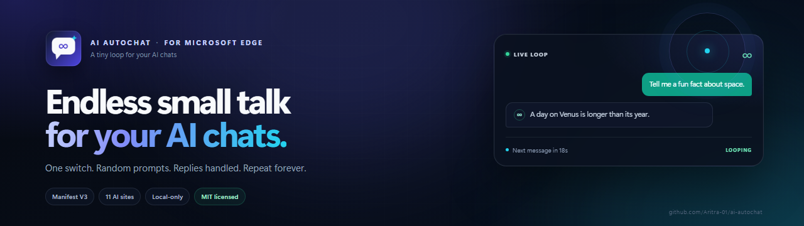
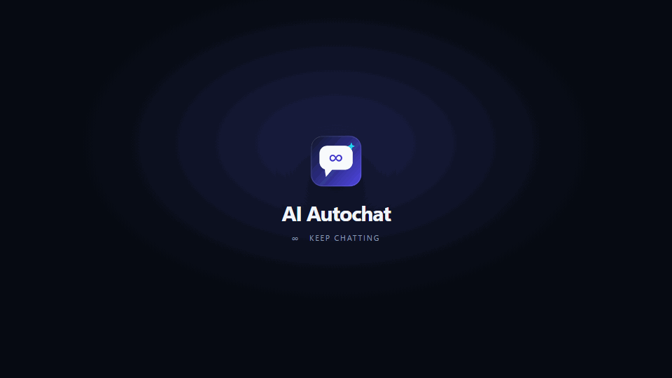
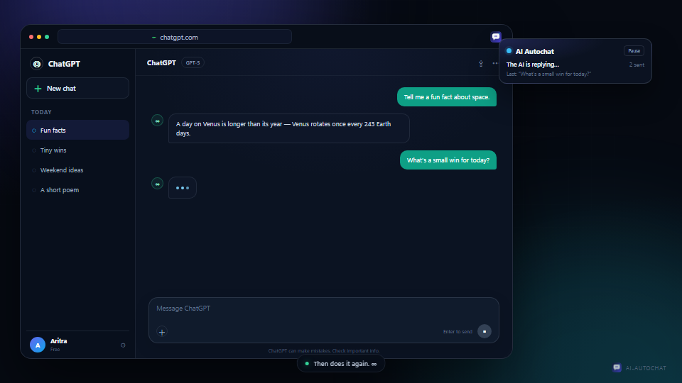

<div align="center">



<br />

**One switch. Random prompts. Replies handled. Repeat forever.**

A tiny Manifest V3 extension for Microsoft Edge that keeps your AI chats moving.

[](manifest.json)
[](LICENSE)
[](https://github.com/Aritra-01/ai-autochat/releases/latest)
[](https://github.com/Aritra-01/ai-autochat)

[**Live demo**](https://aritra-01.github.io/ai-autochat/) ·
[**Install**](#install-in-edge) ·
[**Prompt samples**](docs/samples.md) ·
[**Report a bug**](https://github.com/Aritra-01/ai-autochat/issues/new?template=bug_report.yml)

</div>

---

<p align="center">
  <a href="https://aritra-01.github.io/ai-autochat/">
    
  </a>
</p>

<p align="center"><sub>One loop, from paused to “again.” · <a href="https://aritra-01.github.io/ai-autochat/">Open the live landing page</a></sub></p>

<details>
<summary>Static preview (no animation)</summary>
<p align="center">
  
</p>
</details>

## Why this exists

Sometimes you want a conversation to keep going without turning it into a
production pipeline. AI Autochat is the smallest useful version of that idea:

- It types a short, friendly prompt into an open AI chat.
- It sends the prompt and waits for the reply to finish.
- It waits a randomized delay.
- It does it again. And again, until you turn it off.

No accounts, no cloud, no dashboards. Your browser, your tabs, your prompts.

## Highlights

| | |
| --- | --- |
| **One switch** | Enable it once. The loop runs in every supported open tab and survives browser restarts. |
| **Actually random** | A shuffled bag of 71 short prompts, plus your own custom lines. No immediate repeats. |
| **Reply-aware** | Watches the provider’s stop/streaming control before sending the next prompt, with a timeout fallback. |
| **Eleven sites** | ChatGPT, Gemini, Claude, Copilot, Perplexity, Grok, DeepSeek, Le Chat, Poe, Qwen, and HuggingChat. |
| **Local-only** | No analytics, no telemetry, no servers. Settings live in `chrome.storage.local`. |
| **Editable adapters** | Site selectors are plain data in [`shared/config.js`](shared/config.js). Add a provider in a few lines. |

## Install in Edge

1. Download the [latest release ZIP](https://github.com/Aritra-01/ai-autochat/releases/latest), or clone this repo.
2. Extract it if needed.
3. Open `edge://extensions`.
4. Turn on **Developer mode**.
5. Click **Load unpacked** and select the folder containing [`manifest.json`](manifest.json).
6. Pin AI Autochat from the toolbar’s puzzle-piece menu.

Or clone and load the folder directly:

```powershell
git clone https://github.com/Aritra-01/ai-autochat.git
```

> [!NOTE]
> This is an unpacked extension, not a store listing. Edge may show a
> developer-mode reminder after a restart. That is expected.

## Use it

1. Open and sign in to one or more supported AI chats.
2. Click the AI Autochat toolbar icon.
3. Flip the switch on.
4. Leave the chat tab open. The first prompt goes out as soon as the composer is found.

Use **Send one now** in the popup to test a single message without starting the
loop. Press <kbd>Alt</kbd>+<kbd>Shift</kbd>+<kbd>A</kbd> to toggle the extension
globally, or click **Pause** on the small on-page chip.

### Settings

| Setting | Default | What it does |
| --- | --- | --- |
| **Switch** | Off | Master on/off for every supported tab. |
| **Shortest wait** | 20 sec | Lower bound of the randomized delay. Minimum 5 sec. |
| **Longest wait** | 45 sec | Upper bound. |
| **Wait for each reply** | On | Watches for the provider’s stop/streaming state before continuing. |
| **Give up waiting after** | 300 sec | Fallback timeout for unusually long replies. |
| **Show on-page chip** | On | Draggable status card with a pause button. |
| **Custom messages** | Empty | One prompt per line. Empty means the built-in 71. First 200 lines, up to 1,000 characters each. |

## A few things it might say

| Small talk | Curious | Creative | Kind |
| --- | --- | --- | --- |
| “Hey! Tell me a fun fact in one sentence.” | “What’s something surprising about the ocean?” | “Give me a random word and a tiny poem about it.” | “What’s a simple way to brighten someone’s day?” |
| “What’s a small thing that made you smile today?” | “Tell me a cool fact about trees.” | “Describe a dream treehouse.” | “Give me a random act of kindness idea.” |
| “Recommend a song for a sunny morning.” | “What’s a fun fact about space?” | “Suggest a name for a small coffee shop.” | “What’s a nice thing to say to a friend?” |

Need more? Copy a ready-made pack from [**docs/samples.md**](docs/samples.md),
or hit **Shuffle** on the [landing page](https://aritra-01.github.io/ai-autochat/#samples)
and copy four prompts at once.

## Supported sites

| Provider | Hosts | Adapter |
| --- | --- | --- |
| ChatGPT | `chatgpt.com`, `chat.openai.com` | `#prompt-textarea` + stop button |
| Gemini | `gemini.google.com` | Quill editor + “Stop response” |
| Claude | `claude.ai` | ProseMirror editor + “Stop response” |
| Copilot | `copilot.microsoft.com` | Textarea composer |
| Perplexity | `perplexity.ai`, `www.perplexity.ai` | Textarea + submit |
| Grok | `grok.com`, `www.grok.com` | Generic composer/send adapter |
| DeepSeek | `chat.deepseek.com` | Textarea + generic send |
| Mistral Le Chat | `chat.mistral.ai` | Generic contenteditable adapter |
| Poe | `poe.com`, `www.poe.com` | Generic contenteditable/textarea |
| Qwen Chat | `chat.qwen.ai` | Generic adapter |
| HuggingChat | `huggingface.co/chat*` | Generic adapter |

These are best-effort adapters. AI sites redesign often, and a selector can break
overnight. The fix usually lives in [`shared/config.js`](shared/config.js) and
takes a few lines.

## How the loop works

```text
┌──────────────┐   ┌──────────────┐   ┌──────────────┐   ┌──────────────┐
│  Pick prompt │ → │ Type + send  │ → │ Wait for the │ → │ Random delay │
│  (shuffle)   │   │ into the tab │   │ reply to end │   │   20–45s     │
└──────────────┘   └──────────────┘   └──────────────┘   └──────┬───────┘
       ↑                                                          │
       └──────────────────── repeat until paused ────────────────┘
```

The scheduler lives in the content script, so it keeps working while MV3’s
service worker sleeps. Closing the tab, closing Edge, or discarding the tab
stops that loop. Background tabs may be throttled by the browser, so the real
delay can be longer than configured.

## Prompt packs

The `docs/samples.md` file contains four copy-paste packs:

- **Small talk** — light, human openers.
- **Curious** — short “tell me something” questions.
- **Creative** — tiny story, poem, and naming prompts.
- **Kind** — compliments, tiny challenges, and reflection questions.

Paste one prompt per line into **Messages & options → Custom messages**.

## Privacy and responsible use

> [!WARNING]
> This automates your own logged-in browser session. Automated activity may
> violate a provider’s terms, trigger rate limits, or get an account
> restricted. Keep delays at 20 seconds or more, use it for light personal
> experiments, and stop if a site asks you to slow down or shows a CAPTCHA.

- No analytics, telemetry, external servers, or remote code.
- No account connection. Prompts are typed into the page as if you typed them.
- The extension reads the page only to find inputs, buttons, and reply state.
- Not affiliated with OpenAI, Google, Anthropic, Microsoft, Perplexity, xAI,
  DeepSeek, Mistral, Poe, Alibaba, or Hugging Face.

## Project layout

```text
ai-autochat/
├── manifest.json          Manifest V3, permissions, content-script matches
├── background.js          Badge, defaults, keyboard toggle, auto-injection
├── shared/config.js       Site adapters, defaults, 71 built-in prompts
├── content/               Typing, sending, reply detection, loop, status chip
├── popup/                 Toolbar popup: switch, timing, tabs, samples
├── docs/                  Landing page, animated preview, prompt packs
├── icons/                 Generated extension icons
├── scripts/               Reproducible icon generator
├── LICENSE                MIT
└── README.md
```

Reload the extension from `edge://extensions` after changing content-script
code, then refresh the AI tab.

## Development

There is no build step. The extension is plain HTML, CSS, and JavaScript.

```powershell
git clone https://github.com/Aritra-01/ai-autochat.git
cd ai-autochat
pwsh scripts/validate.ps1
```

The validator checks JavaScript syntax, the manifest, and the key landing-page
assets. CI is intentionally omitted; this is a small, dependency-free project.

The landing page is served straight from `docs/`:

```powershell
python -m http.server 8000 --directory docs
```

Then open `http://localhost:8000`.

See [CONTRIBUTING.md](CONTRIBUTING.md) for the short version, and
[SECURITY.md](SECURITY.md) for private vulnerability reports.

## If this made you smile

Star the repo. Share the loop. Open an issue with a site that needs a new adapter.

<p align="center">
  <a href="https://github.com/Aritra-01/ai-autochat">
    
  </a>
</p>

## License

[MIT](LICENSE) © 2026 Aritra-01.

<div align="center">
  <sub>Built for Microsoft Edge · Manifest V3 · No data leaves your browser.</sub>
</div>
